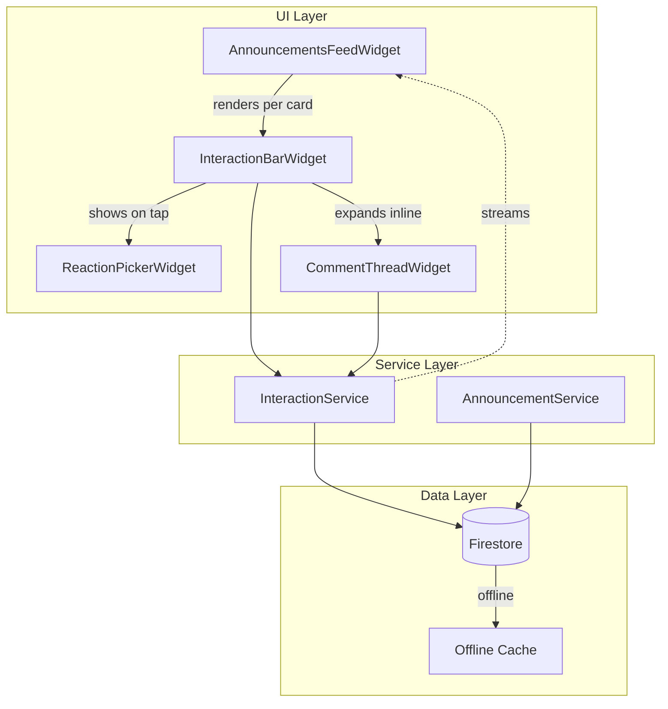

# Design Document

## Feature: announcement-interactions

---

## Overview

This feature extends the Hope Academy announcement feed from a read-only notice board into a two-way social channel. Users (teachers and students/parents) can express reactions with five emoji options and post threaded comments beneath each announcement, mirroring the experience of a school forum or a lightweight Facebook-style post.

The implementation is additive: the existing `AnnouncementModel`, `AnnouncementService`, and `AnnouncementsFeedWidget` are extended rather than replaced. A new `InteractionService` isolates all reaction/comment Firestore I/O, a new `CommentModel` represents comment documents, and two new UI components handle the interaction bar and comment thread rendering.

**Key design goals:**
- Real-time sync via Firestore streams for both reactions and comments
- Optimistic UI for reactions so the feed feels instant
- Inline expanded comment thread (no navigation push) to preserve scroll context
- Dark-mode-aware styling using the existing `AppColors` and `AppTheme` tokens
- Atomic Firestore writes using `FieldValue.increment` to keep reaction counts consistent

---

## Architecture



### Data Flow — Reaction (Optimistic Write)

```
User taps emoji
  → InteractionBarWidget applies optimistic state locally
  → calls InteractionService.setReaction(...)
      → Firestore batch: write reactions/{uid} + FieldValue.increment on announcement
  → on success: Firestore stream confirms → UI stays consistent
  → on failure: InteractionBarWidget reverts local state + shows error snackbar
```

### Data Flow — Comment Submit

```
User types text and taps Send
  → InteractionService.addComment(...)
      → Firestore: add to announcements/{id}/comments sub-collection
  → Firestore real-time stream pushes new document → CommentThreadWidget rebuilds
  → on failure: error snackbar
```

---

## Components and Interfaces

### 1. `InteractionService` (new — `lib/services/interaction_service.dart`)

Handles all Firestore reads and writes for reactions and comments.

```dart
class InteractionService {
  // Streams
  Stream<Map<String, int>> streamReactionCounts(String announcementId);
  Stream<String?> streamUserReaction(String announcementId, String userId);
  Stream<List<CommentModel>> streamComments(String announcementId);

  // Reactions
  Future<void> setReaction({
    required String announcementId,
    required String userId,
    required String? emoji,   // null = remove reaction
    required String? previousEmoji,
  });

  // Comments
  Future<void> addComment({
    required String announcementId,
    required String authorUid,
    required String authorName,
    required String authorRole,
    required String text,
  });

  Future<void> deleteComment({
    required String announcementId,
    required String commentId,
  });
}
```

**Reaction write strategy:** A single Firestore `WriteBatch` performs three operations atomically:
1. Set/delete `announcements/{id}/reactions/{userId}` with `{emoji, createdAt}`.
2. `FieldValue.increment(-1)` on the previous emoji key in `reactionCounts` (if replacing/removing).
3. `FieldValue.increment(+1)` on the new emoji key in `reactionCounts` (if setting).

This keeps the denormalised `reactionCounts` map on the announcement document consistent without a Cloud Function.

### 2. Extended `AnnouncementModel` (`lib/models/announcement_model.dart`)

Two new fields are added; both default to safe empty values for backward compatibility with existing Firestore documents that pre-date this feature.

```dart
final Map<String, int> reactionCounts;  // e.g. {"👍": 3, "❤️": 1}
final int commentCount;
```

`fromFirestore` reads these with `Map<String, dynamic>.from(d['reactionCounts'] ?? {})` cast to `Map<String, int>`, and `(d['commentCount'] as int?) ?? 0`.

`toFirestore` omits both fields — they are written exclusively by `InteractionService` and are never overwritten by the `AnnouncementService.create` path.

### 3. `CommentModel` (new — `lib/models/comment_model.dart`)

```dart
class CommentModel {
  final String id;           // Firestore document ID
  final String authorUid;
  final String authorName;
  final String authorRole;
  final String text;
  final DateTime createdAt;

  factory CommentModel.fromFirestore(DocumentSnapshot doc);
  Map<String, dynamic> toFirestore();
}
```

### 4. `InteractionBarWidget` (new — `lib/widgets/interaction_bar_widget.dart`)

A stateful widget rendered at the bottom of each announcement card. Manages its own optimistic reaction state.

**Props:**
```dart
final String announcementId;
final Map<String, int> initialReactionCounts;
final int initialCommentCount;
final UserModel currentUser;
final VoidCallback onCommentToggle;  // tells the card to expand/collapse thread
```

**Behaviour:**
- Subscribes to `InteractionService.streamUserReaction` and `streamReactionCounts` on init.
- Maintains local `_optimisticCounts` and `_optimisticUserEmoji` for instant feedback.
- Shows `ReactionPickerWidget` via an `OverlayEntry` anchored above the react button with a scale + fade animation.
- Displays active emoji highlighted in `AppColors.primary` background pill.
- Falls back gracefully when the announcement ID starts with `'mock-'` (disables interactions on mock data).

### 5. `ReactionPickerWidget` (new — `lib/widgets/reaction_picker_widget.dart`)

A small floating row of five emoji buttons (`['👍', '❤️', '😮', '😢', '😡']`) displayed as an `OverlayEntry` with a `ScaleTransition` + `FadeTransition` originating from the react button's position. Tapping an emoji fires the callback and dismisses the picker; tapping elsewhere dismisses without reacting.

### 6. `CommentThreadWidget` (new — `lib/widgets/comment_thread_widget.dart`)

Inline-expanded section (not a `showModalBottomSheet`) rendered directly inside the announcement card column when `_isExpanded == true`. This preserves the scrolling feed context.

**Structure:**
```
└── AnimatedSize (duration: 300ms, curve: easeInOut)
    └── Column
        ├── Divider
        ├── ListView of CommentTileWidget (shrinkWrap, NeverScrollableScrollPhysics)
        └── CommentComposeBar (TextField + Send IconButton)
```

Subscribes to `InteractionService.streamComments(announcementId)`.

### 7. `CommentTileWidget` (new — inline in `comment_thread_widget.dart`)

Renders a single comment: author avatar initial, display name, role badge, relative timestamp, and comment text. Shows delete `IconButton` if the current user is admin, sub-admin, or the comment author.

### 8. Updated `AnnouncementsFeedWidget`

The `_buildAnnouncementCard` method gains an `_expandedCommentAnnouncementId` state variable. Each card's bottom area conditionally renders:
```dart
InteractionBarWidget(
  announcementId: item.id,
  initialReactionCounts: item.reactionCounts,
  initialCommentCount: item.commentCount,
  currentUser: user!,
  onCommentToggle: () => setState(() { ... }),
)
if (_expandedId == item.id)
  CommentThreadWidget(announcementId: item.id, currentUser: user!)
```

---

## Data Models

### Firestore Schema

```
announcements/{announcementId}
  title: string
  content: string
  category: string
  authorName: string
  authorRole: string
  createdAt: timestamp
  targetRole: string
  isPinned: bool
  reactionCounts: map<string, int>   ← NEW (denormalised tally)
  commentCount: int                  ← NEW (denormalised count)

  reactions/{userId}                 ← sub-collection (one doc per user)
    emoji: string                    ← e.g. "👍"
    createdAt: timestamp

  comments/{autoId}                  ← sub-collection
    authorUid: string
    authorName: string
    authorRole: string
    text: string
    createdAt: timestamp
```

### Reaction Document

| Field | Type | Notes |
|---|---|---|
| `emoji` | `String` | One of: 👍 ❤️ 😮 😢 😡 |
| `createdAt` | `Timestamp` | Server-side write time |

The document ID is the user's `uid`, enforcing the one-reaction-per-user constraint at the document level.

### Comment Document

| Field | Type | Notes |
|---|---|---|
| `authorUid` | `String` | Firebase Auth UID |
| `authorName` | `String` | Full name at time of posting |
| `authorRole` | `String` | Role label at time of posting |
| `text` | `String` | Raw comment text |
| `createdAt` | `Timestamp` | Server-side write time |

### Firestore Security Rules (reference)

```
rules_version = '2';
service cloud.firestore {
  match /databases/{db}/documents {
    function isAuth() { return request.auth != null; }
    function isAdminOrSubAdmin() {
      return get(/databases/$(db)/documents/users/$(request.auth.uid)).data.role
             in ['admin', 'subAdmin'];
    }

    match /announcements/{aid}/reactions/{uid} {
      allow read: if isAuth();
      allow write: if isAuth() && request.auth.uid == uid;
    }

    match /announcements/{aid}/comments/{cid} {
      allow read: if isAuth();
      allow create: if isAuth()
        && request.resource.data.authorUid == request.auth.uid;
      allow delete: if isAuth()
        && (resource.data.authorUid == request.auth.uid || isAdminOrSubAdmin());
    }
  }
}
```

### `CommentModel` — full Dart definition

```dart
import 'package:cloud_firestore/cloud_firestore.dart';

class CommentModel {
  final String id;
  final String authorUid;
  final String authorName;
  final String authorRole;
  final String text;
  final DateTime createdAt;

  const CommentModel({
    required this.id,
    required this.authorUid,
    required this.authorName,
    required this.authorRole,
    required this.text,
    required this.createdAt,
  });

  factory CommentModel.fromFirestore(DocumentSnapshot doc) {
    final d = doc.data() as Map<String, dynamic>;
    return CommentModel(
      id: doc.id,
      authorUid: d['authorUid'] ?? '',
      authorName: d['authorName'] ?? 'Unknown',
      authorRole: d['authorRole'] ?? '',
      text: d['text'] ?? '',
      createdAt: (d['createdAt'] as Timestamp?)?.toDate() ?? DateTime.now(),
    );
  }

  Map<String, dynamic> toFirestore() => {
    'authorUid': authorUid,
    'authorName': authorName,
    'authorRole': authorRole,
    'text': text,
    'createdAt': FieldValue.serverTimestamp(),
  };
}
```

### `AnnouncementModel` extension (diff)

```dart
// New fields
final Map<String, int> reactionCounts;
final int commentCount;

// In fromFirestore:
reactionCounts: Map<String, int>.from(
  (d['reactionCounts'] as Map<String, dynamic>? ?? {})
    .map((k, v) => MapEntry(k, (v as num).toInt())),
),
commentCount: (d['commentCount'] as num?)?.toInt() ?? 0,

// In toFirestore: these fields are intentionally OMITTED
// (managed solely by InteractionService)
```

---

## Correctness Properties

*A property is a characteristic or behavior that should hold true across all valid executions of a system — essentially, a formal statement about what the system should do. Properties serve as the bridge between human-readable specifications and machine-verifiable correctness guarantees.*

### Property 1: Reaction count consistency after set

*For any* announcement and any user, after `setReaction` is called with an emoji, the `reactionCounts` map on the announcement document shall reflect an increment of exactly 1 for that emoji type and no change to any other emoji type (compared to the state before the call, assuming the user had no prior reaction).

**Validates: Requirements 1.3, 5.3**

---

### Property 2: Reaction toggle (same emoji removes)

*For any* announcement and any user who already holds a reaction with emoji E, calling `setReaction` with emoji E again shall result in the user having no active reaction and the count for E being decremented by exactly 1.

**Validates: Requirements 1.5**

---

### Property 3: Reaction replace preserves total correctness

*For any* announcement and any user who holds reaction E1, calling `setReaction` with a different emoji E2 shall decrement the count for E1 by 1, increment the count for E2 by 1, and leave all other emoji counts unchanged.

**Validates: Requirements 1.4, 5.3**

---

### Property 4: Comment text round-trip

*For any* valid (non-empty, non-whitespace-only) comment text, after `addComment` writes the comment and `streamComments` returns the document, the `text` field retrieved shall equal the original text.

**Validates: Requirements 2.4, 5.2**

---

### Property 5: Empty/whitespace comment rejection

*For any* string composed entirely of whitespace characters (including the empty string), the UI shall not invoke `InteractionService.addComment` and the compose field shall remain focused.

**Validates: Requirements 2.5**

---

### Property 6: Comment ordering invariant

*For any* sequence of comments written to a given announcement's sub-collection, `streamComments` shall always emit them in non-decreasing `createdAt` order (oldest first).

**Validates: Requirements 2.2**

---

### Property 7: Comment display fields completeness

*For any* `CommentModel` rendered by `CommentTileWidget`, the rendered widget tree shall contain the author's display name, role label, comment text, and a relative timestamp string.

**Validates: Requirements 2.7**

---

### Property 8: Delete removes from stream

*For any* comment that exists in the stream, after `deleteComment` is called, the next emission from `streamComments` shall not contain that comment's ID.

**Validates: Requirements 3.3, 3.4**

---

### Property 9: Reaction display reflects user's active reaction

*For any* announcement where the current user has an active reaction emoji E, the `InteractionBarWidget` shall render E with a highlighted (primary-color) background pill, and no other emoji in the bar shall be highlighted.

**Validates: Requirements 1.8**

---

### Property 10: Delete icon visibility for moderators and comment authors

*For any* `CommentModel` and any user whose role is admin, sub-admin, or whose `uid` equals `comment.authorUid`, the rendered `CommentTileWidget` shall contain a delete icon button. For any other user, no delete icon shall be rendered.

**Validates: Requirements 3.1, 3.2**

---

### Property 11: Reaction summary shows only non-zero emoji in descending order

*For any* `reactionCounts` map, the `InteractionBarWidget` shall display only those emoji keys whose count is greater than zero, and they shall appear in non-increasing count order from left to right.

**Validates: Requirements 6.3**

---

## Error Handling

| Scenario | Detection | Recovery |
|---|---|---|
| Reaction write fails (network / permission) | `Future` returned by `setReaction` throws | `InteractionBarWidget` catches, reverts optimistic counts, shows `SnackBar` with error message |
| Comment write fails | `Future` returned by `addComment` throws | `CommentThreadWidget` catches, shows `SnackBar`, keeps compose field text intact |
| Comment delete fails | `Future` returned by `deleteComment` throws | `CommentThreadWidget` catches, shows `SnackBar`, comment remains visible |
| Firestore temporarily unavailable | Firestore SDK serves offline cache; stream continues with cached data | Connectivity warning banner rendered above feed (checks `FirebaseFirestore.instance.snapshotsInSync`) |
| Unauthenticated write attempt | Firestore Security Rules reject the write; `Future` throws `FirebaseException` | `InteractionService` re-throws; caller shows auth error snackbar |
| Mock announcement (id starts with `'mock-'`) | Checked in `InteractionBarWidget` constructor | Interaction controls are rendered disabled/muted; no Firestore calls are made |

**Error Snackbar pattern** (consistent with existing app):
```dart
ScaffoldMessenger.of(context).showSnackBar(
  SnackBar(
    content: Text(message),
    backgroundColor: AppColors.error,
    behavior: SnackBarBehavior.floating,
  ),
);
```

---

## Testing Strategy

### Unit Tests

Test the pure logic layers that don't require Firestore:

- **`CommentModel.fromFirestore` / `toFirestore`**: Verify round-trip serialization with arbitrary field values.
- **`AnnouncementModel` extensions**: Verify `reactionCounts` parsing with missing, null, and populated map values; verify `commentCount` defaults to 0 when absent.
- **`_formatTimeAgo` / relative timestamp helper**: Verify output strings for seconds, minutes, hours, and days.
- **`ReactionPicker` emoji list**: Verify the picker widget renders exactly five emoji items.
- **Whitespace validation in `CommentComposeBar`**: Verify that strings of spaces, tabs, and newlines are rejected.

### Property-Based Tests

This feature qualifies for property-based testing on the pure business logic functions (reaction count arithmetic, comment serialization, text validation). The recommended library is [**`fast_check`**](https://pub.dev/packages/fast_check) (a Dart PBT library) with a minimum of **100 iterations per property**.

Each property test must be tagged with:
```dart
// Feature: announcement-interactions, Property N: <property text>
```

**Properties to implement as PBT:**

| Property | Generator | What to verify |
|---|---|---|
| P1: Reaction count consistency after set | Random announcementId, userId, emoji from the 5 valid values | Count for that emoji incremented by 1, others unchanged |
| P2: Reaction toggle removes | Same generators, user pre-seeded with a reaction | Count decremented to 0, user reaction is null |
| P3: Reaction replace consistency | Two distinct emojis drawn from the 5 valid values | E1 count -1, E2 count +1, others unchanged |
| P4: Comment text round-trip | Random non-empty, non-whitespace strings | `fromFirestore(toFirestore(comment)).text == original` |
| P5: Empty/whitespace rejection | Strings from whitespace character set, arbitrary lengths | Validation function returns false for all |
| P6: Comment ordering | Random list of `CommentModel` with random `createdAt` | After sorting by `createdAt`, stream emissions are non-decreasing |
| P7: Comment display completeness | Random `CommentModel` instances | Widget tree contains name, role, text, and timestamp sub-string |
| P8: Delete removes from stream | Random comment list, random index to delete | Post-delete list does not contain deleted ID |
| P9: Active reaction highlighting | Random emoji choice | Only the matching emoji chip has primary-color background |
| P10: Delete icon visibility | Random `CommentModel`, random user (admin / sub-admin / author / other) | Delete icon present iff user is admin, sub-admin, or comment author |
| P11: Reaction summary display order | Random `reactionCounts` maps with arbitrary counts | Only emojis with count > 0 shown, in non-increasing order |

### Integration Tests

Run against a Firestore emulator (`firebase emulators:start`):

- **Reaction sub-collection write**: Assert document exists at correct path with correct emoji field.
- **`reactionCounts` atomic update**: Assert announcement document counts match after a batch of concurrent reactions.
- **Comment sub-collection ordering**: Assert `streamComments` query returns docs in ascending `createdAt`.
- **Security rules**: Assert unauthenticated writes to reactions and comments are rejected with `permission-denied`.
- **Comment delete authorisation**: Assert admin can delete any comment; assert a non-owner, non-admin user cannot delete another's comment.

### Widget Tests

- `InteractionBarWidget` renders reaction summary correctly when counts are provided.
- `CommentThreadWidget` displays all comments from a mock stream.
- Reaction picker overlay appears and dismisses correctly.
- Optimistic update reverts visually when the service future throws.
- Dark-mode rendering: widget tests run with `ThemeData.dark()` injected to confirm no hard-coded light colours.
